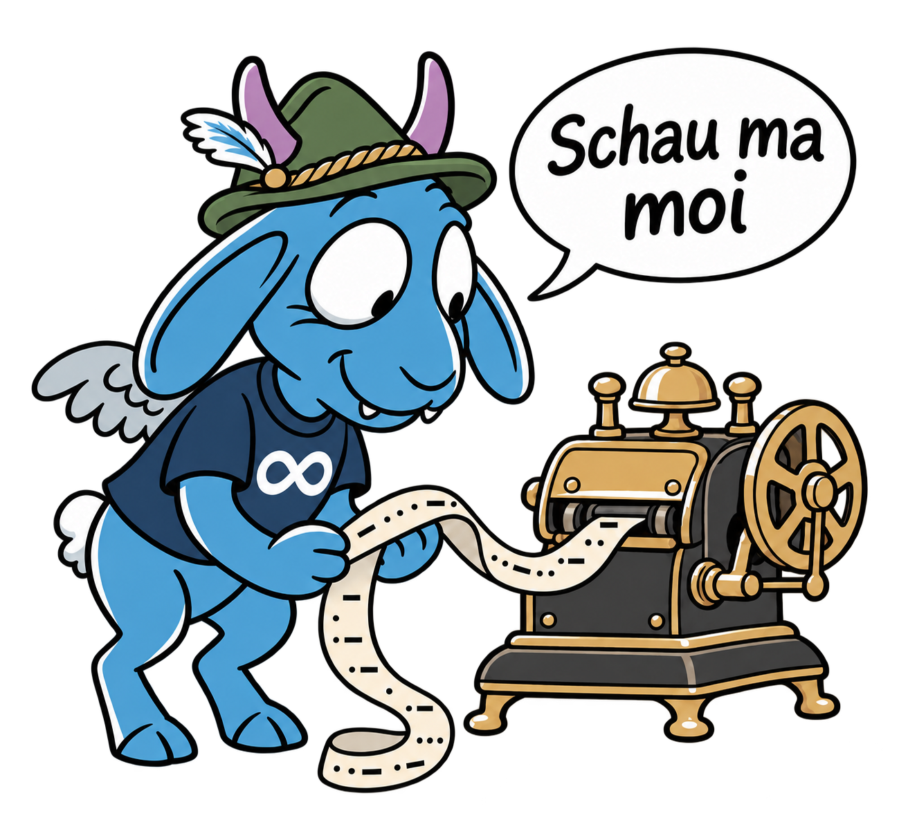

<p align="center">
  
</p>

# schau ma moi

“Schau ma moi” is Bavarian dialect for “Let’s have a look” or “Let’s see.”

event aggregation, metering and analysis

Processes GA4 event data as produced by [`foomo/sesamy-go`](https://github.com/foomo/sesamy-go):
it folds a shopper's events into a personalization vector, and tests that against
deterministic traffic from a mock shop.

**Documentation: [foomo.github.io/schaumamoi](https://foomo.github.io/schaumamoi/)**

**WARNING: this API is in early development**

## Requirements

The toolchain (Go, Bun for the docs, actionlint) is pinned in `.mise.toml`:

```bash
mise install
```

## Usage

```bash
go test ./...        # run the tests; they also write the documentation's reports
mise run docs        # build the documentation site into docs/.vitepress/dist
mise run docs:dev    # serve it locally with live reload
```

## Packages

| Package | |
|---|---|
| `pkg/personalization` | the sparse taste vector and its (weighted) score |
| `pkg/distillery` | a still per user: fed events, cut and infused once, distilled by any number of recipes, drawn off by rules |
| `pkg/distillery/stamp` | time and session, shared by every still: the stamp infuser and the rules on it |
| `pkg/distillery/stills/affinity` | the still that distills a shopper's personalization vector |
| `pkg/distillery/recipes/visits` | recipes that read any stamped still visit by visit: visits, and phases of steady taste |

The tests drive them with deterministic GA4 traffic from a two-department shop,
`pkg/internal/mock`: test fixtures, not a public API.

How they work, with reports computed from the code by the tests, is in the
[documentation](https://foomo.github.io/schaumamoi/); its sources are in [`docs/`](docs/).
