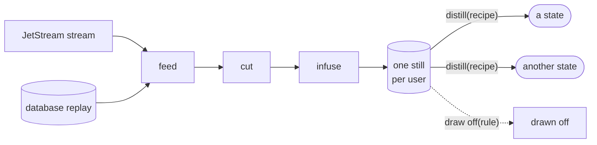
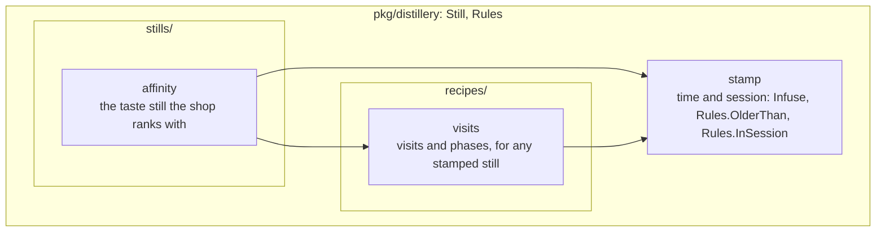

# The distillery

GA4 events reach schaumamoi from a stream (NATS JetStream) or as a replay from a
database. `pkg/distillery` is the step in between: per user, it takes the events in,
works on them once, and keeps them ready for any number of states to be distilled from
them: a taste vector, a funnel, the phases of a history.

| Word | What happens | API |
|---|---|---|
| **feed** | events go into the user's still, a batch at a time, in arrival order | `Still.Feed(envelope, events...)` |
| **cut** | what isn't worth keeping is cut, and gone | `Config.Cut` |
| **infuse** | what is known about each kept event is infused into it, once | `Config.Infusers` |
| **distill** | a recipe reduces the infused events to a state of its own type | `Still.Distill(recipe)` |
| **draw off** | what the still should no longer hold is drawn off, by a rule | `Config.DrawOff`, `Still.DrawOff(rule)` |



```go
still := distillery.New(distillery.Config[Envelope, Params, Infusion]{
    Cut:      keep,      // which events are kept at all
    Infusers: infusers,  // what is infused into each one, in order
    DrawOff:  policy,    // what is drawn off again, after every feed
})

still.Feed(envelope, events...)    // cut and infuse, once, on arrival
spirit := still.Distill(recipe)    // a pure read, as often as you like
still.DrawOff(rule)                // and on request
```

- **Cut and infused once.** `Feed` runs the cut and then the infusers on every event
  as it arrives, and keeps the result. Distilling never infuses again, no matter how
  often or how late it runs.
- **One still, many recipes.** A recipe reduces the infused events to whatever state it
  describes, and the state's type belongs to the recipe. One user's events can answer
  unrelated questions (taste, a funnel, phases of a history) without being fed twice.
  Unlike a real run, distilling uses nothing up.
- **The envelope exists on the way in only.** Each batch comes with an envelope: what
  the routing stage knows beyond the events, such as time, session and consent. The cut
  and the infusers see it, but the still doesn't keep it. Whatever a recipe needs from
  it, an infuser copies into the infusion.
- **Anything relative to now belongs in a recipe.** An infusion is fixed on the way in,
  so recency (decay, fading) is computed when distilling, with "now" handed in rather
  than read off the clock.

## Drawing off

What goes in doesn't have to stay. A `Rule` decides, event by event, what the still
should no longer hold, and it runs two ways:

- **As a standing policy.** `Config.DrawOff` returns a rule for each batch's envelope,
  and the still draws it off after every feed. The batch's time is the still's "now",
  so the policy is judged against the stream, not against the clock.
- **On request.** `Still.DrawOff(rule)` draws off what the rule selects, and reports how
  many events it removed: a session the user asked to forget, everything once consent
  is withdrawn.

Rules are small and compose. They are built from a `Rules` value, which fixes the
still's type arguments once, since Go can't infer them from a rule's own arguments. A
still package declares one, e.g. `var Rules distillery.Rules[any, Infusion]`:

| Rule | Draws off |
|---|---|
| `KeepLast(n)` | everything but the newest `n` |
| `Named(names...)` | events with one of these names |
| `Where(pred)` | whatever `pred` selects, e.g. by something in the infusion |
| `Any(rules...)`, `All(rules...)`, `Not(rule)` | either, both, or the opposite |

Every rule in a composition sees each event's position as it was before the draw-off
began, so the result doesn't depend on the order of the rules. What remains keeps its
arrival order, and drawing off never rewrites a slice a recipe was handed earlier.

Time and session are shared by every still: `pkg/distillery/stamp` has the `Stamp` an
infusion embeds, the infuser `stamp.Infuse` that copies it off the envelope, and
`stamp.Rules`, which adds `OlderThan(now, age)` and `InSession(id)` to the rules above.
The affinity still declares `var Rules stamp.Rules[any, Infusion]` and that is all: no
rule of its own. A policy that forgets browsing after two weeks but keeps what went into
the cart:

```go
DrawOff: func(env affinity.Envelope) affinity.Rule {
    r := affinity.Rules
    browsing := r.Named(sesamy.EventNameSelectItem, sesamy.EventNameViewItem)

    return r.Any(
        r.KeepLast(affinity.DefaultKeep),
        r.All(browsing, r.OlderThan(env.Stamped().At, 14*24*time.Hour)),
    )
},
```

The cut, by contrast, never forgets by time: it judges each event once, on its own, and
what it cuts never gets in.

## Where things live



The arrows are imports. `pkg/distillery` itself, the `Still` with `Feed`, `Cut`,
`Infuse`, `Distill`, `DrawOff` and `Rules`, imports none of them.

A package under `stills/` is one still's setup: its `Infusion`, its cut and infusers,
`New`, and the recipes and rules that read what it infuses. A package under `recipes/`
holds recipes that work on any still whose infusion meets their constraint, such as
`visits` on any stamped still. New stills (what a shopper was shown, what they are worth,
how far their visits get) go under `stills/`, next to `affinity`.

## The affinity still

`pkg/distillery/stills/affinity` is the still the shop uses: a fixed setup on top of
`pkg/distillery`.

- **Envelope:** the sesamy-go envelope itself. `affinity.Envelope` is `mpv2.Payload[any]`
  as a type of its own, so a payload off the stream converts for free,
  `still.Feed(affinity.Envelope(payload), payload.Events...)`, and nothing in it is lost.
  It adds the two readings the still needs: `Stamped()` (`timestamp_micros` and
  `session_id`) and `Personalization()` (whether the consent grants personalization
  storage).
- **Cut:** it keeps only a shopper's choices (`select_item`, `view_item`,
  `add_to_cart`), never listings. Listings are what the shop offered, not what the
  shopper chose.
- **Infusers:** `Stamp` copies each choice's time and session off the envelope (the
  shared `stamp.Infuse`), `AddAttractors` sums the attractors of its items into one taste
  vector, and `WeighByIntent` weighs it: a selection or view counts once, a cart three times.
- **Recipes:** `Flat` sums everything, `Decayed` fades by time, and `Fade.Vector`
  fades per choice. `Fade.Vector` is [the personalization vector](/guide/vector) the
  shop ranks every listing with. `Phases` cuts a history into [phases of steady
  taste](/guide/visits).
- **Draw off:** it holds the newest `DefaultKeep` (1000) choices, and draws off the rest
  after every feed.

[The distillery](/reports/distillery) report draws this setup from the code and traces
one visit through it, request by request.
