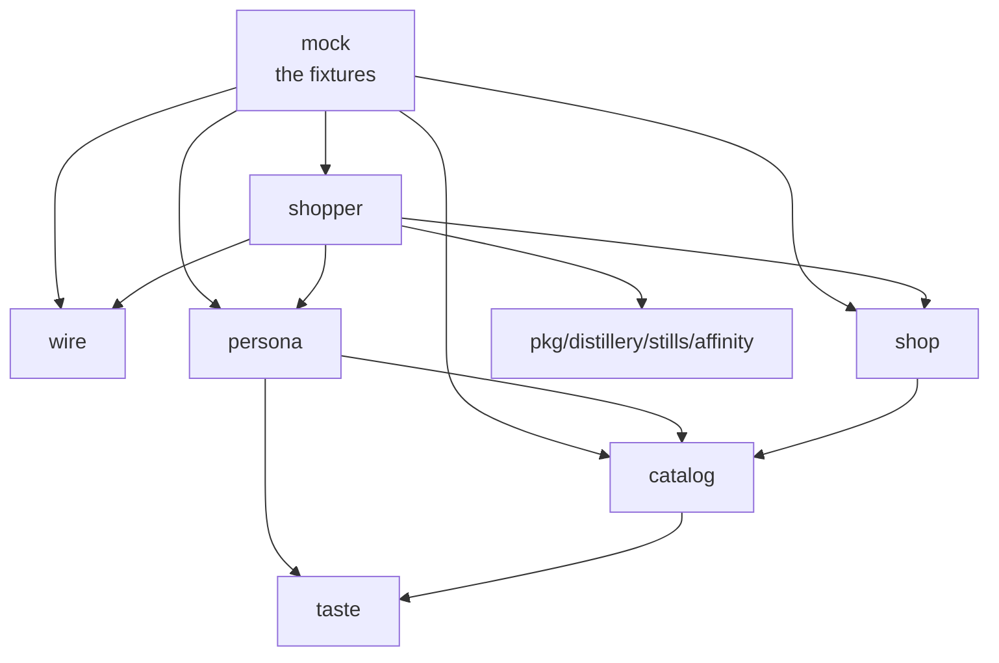

# Test shop

The tests run against a shop: `pkg/internal/mock` generates deterministic GA4 traffic
from a shop with two departments, women's fashion and home decoration. Personas with a
hidden taste browse it, open and buy what they like, request by request, while the shop
ranks every listing with the personalization vector the affinity still distills from what
they did.

It is internal: test fixtures for this module, free to change, not an API. But it is
what the [reports](/reports/catalog) and these guides use to show the packages at work,
so it is split the way a real shop is, and these pages follow that split.

## Packages

| Package | What it is | Guide | Report |
|---|---|---|---|
| `mock/taste` | the dimensions taste is described in | [Catalog](./catalog#dimensions) | |
| `mock/catalog` | what the shop sells: products, category tree, weights, `Score` | [Catalog](./catalog) | [Catalog](/reports/catalog) |
| `mock/persona` | the four shoppers' tastes, and how a shopper picks | [Personas](./personas) | [Personas](/reports/personas) |
| `mock/shop` | listings, ranked by a profile, and the GA4 events they report | [Shop](./shop) | [Shop](/reports/shop) |
| `mock/shopper` | a persona taken through the shop: journeys and histories | [Shoppers](./shoppers) | [Shoppers](/reports/shoppers) |
| `mock/wire` | the Measurement Protocol envelope, and a visit as requests | [Events on the wire](./wire) | |
| `mock` | the fixtures in `testdata` and the images, built from all of the above | [Events on the wire](./wire#fixtures) | |

## Who knows what



The arrows are imports (`wire` needs nothing but sesamy-go), and they carry the shop's
one rule: **the shop never sees a persona.** `shop` imports the catalog and nothing that
knows a shopper's taste. It ranks every listing by a `shop.Profile`, the vector an
affinity still (`pkg/distillery/stills/affinity`) distills from the shopper's events so
far. Only `shopper` brings a persona and the shop together. The persona decides what
gets picked, and the shop has to learn it from the picks.

## In a test

```go
import (
    "github.com/foomo/schaumamoi/pkg/distillery/stills/affinity"
    "github.com/foomo/schaumamoi/pkg/internal/mock/persona"
    "github.com/foomo/schaumamoi/pkg/internal/mock/shopper"
)

visit := shopper.Journey(persona.Sofia)              // wire.Session: one request per event
month := shopper.History(shopper.Month(persona.Kate)) // []wire.Session, 7 visits

still := affinity.New(nil) // the shopper's still
for _, request := range visit {
    still.Feed(affinity.Envelope(request), request.Events...) // each request as sent
}
```
