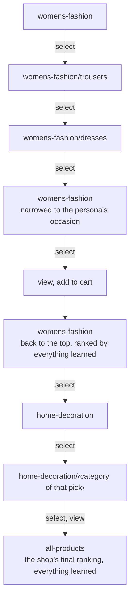

# Shoppers

`pkg/internal/mock/shopper` takes a [persona](./personas) through [the shop](./shop):
the only package that knows both. The persona picks; the shop ranks every listing with
the vector the shopper's events add up to at that moment. Each event goes into the
shopper's affinity still (`pkg/distillery/stills/affinity`) as it happens, so the
next listing is already ranked with it. The [shoppers exhibit](/exhibits/shoppers) shows
every journey step by step, every month, and the shop's final rankings.

```go
shopper.Journey(persona.Sofia)      // wire.Session, converts
shopper.BrowseJourney(persona.Lena) // browses and leaves
```

## A journey

A journey crosses the rails before it decides:



Every listing but the last is followed by a `select_item` carrying its list id: what
the persona [chooses](./personas#how-a-persona-chooses) from it, and what it views and
buys is what it opened. A browsing visit takes the same route and leaves after the view.

A first visit, with no events yet, lands on the catalog order, and each listing after it
is ranked with one more pick. Every visit closes back on the top-level department,
ranked by all the visit has shown, and ends on the listing of all products, without
another click: the shop's whole ranking for this shopper, across both departments. Read
per category, in every category the shopper chose from, that category's first product
is one the persona likes. A test replays each journey's own events into a fresh still
and checks every listing's order against the vector it distills.

Nothing is hardcoded per persona: the occasion comes from the persona's strongest
occasion dimension and the product from its highest affinity score. Change a persona's
vector and its journey follows.

## At a shopper's pace

A visit reaches the wire the way a real client sends it: not as one envelope, but as a
`wire.Session`, one request per event. Each request carries its own `timestamp_micros`
and an `engagement_time_msec` of the time since the previous request, and all share the
visit's session id. The requests follow each other at a shopper's pace, seeded so the
fixtures don't churn:

| After | Next request |
|---|---|
| a listing | 5–25 s (scanning it) |
| a selection | 20–75 s (looking at the product) |
| a product view | 15–60 s |
| an add to cart | 5–15 s |

## Histories

A returning shopper is a history: one session per visit, oldest first. Each session
starts at its scheduled time, and its session id is derived from that time, the way GA4
does:

```go
shopper.History(shopper.Month(persona.Kate))  // []wire.Session, 7 visits
```

`Month` spans the four weeks up to `wire.BaseTime`, mostly browsing, converting twice.
The shopper's still carries over from visit to visit, the way a shop recognises a
returning client. The persona is set per `shopper.Visit`, so the intent can change
within one history: overwrite the persona of some visits and the shopper wants
something else from then on. That is what the [affinity vector](../vector) is tested with.
